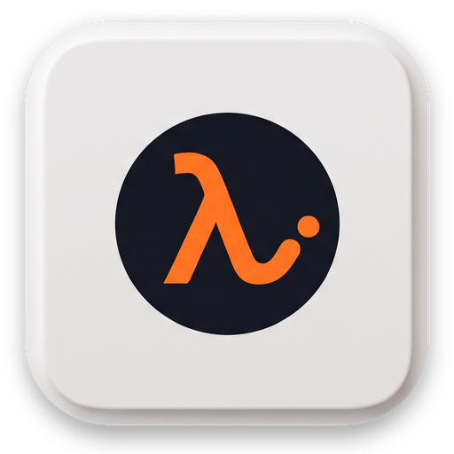
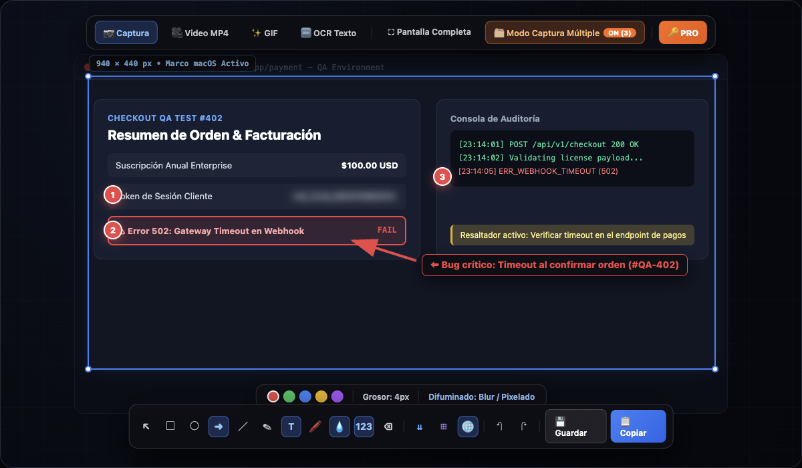
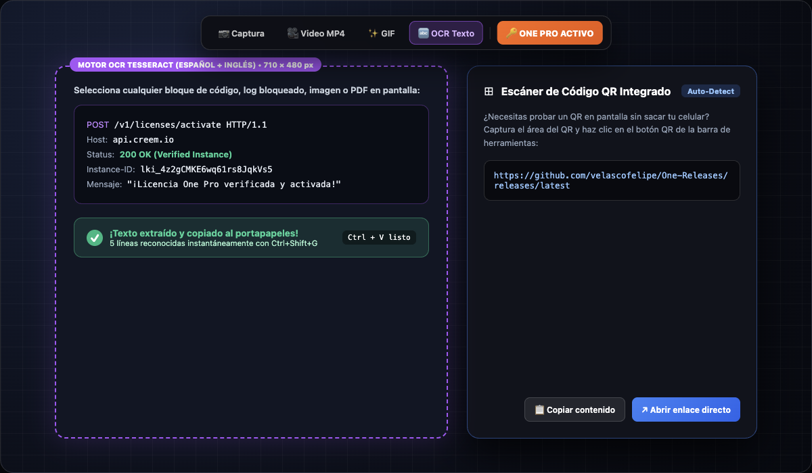
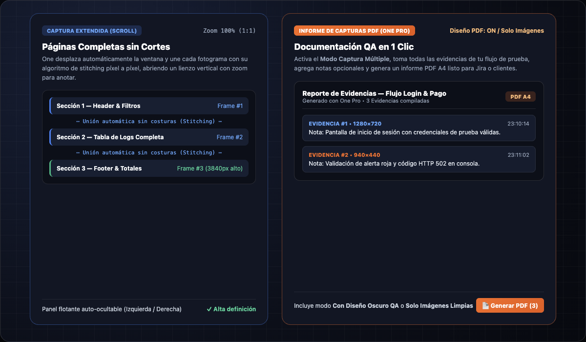

# One — Suite Profesional de Captura, Edición, OCR, Scroll y Evidencia QA

**La herramienta definitiva de escritorio para Desarrolladores, QA Engineers y equipos técnicos que necesitan capturar, anotar, extraer texto (OCR), grabar pantalla y generar informes de evidencia en segundos.**

[-2563eb?style=for-the-badge&logo=windows)](https://github.com/velascofelipe/One-Releases/releases/latest)

 

### 📥 [Descargar Instalador para Windows (`One-Windows-Setup.exe`)](https://github.com/velascofelipe/One-Releases/releases/latest/download/One-Windows-1.2.0-Setup.exe) &nbsp;|&nbsp; 📦 [Descargar Versión Portable](https://github.com/velascofelipe/One-Releases/releases/latest/download/One-Windows-1.2.0-Portable.exe)

---

## 🚀 ¿Qué es One?

**One** nace desde la experiencia real en **Desarrollo de Software y Aseguramiento de Calidad (QA)**. Cuando estás ejecutando pruebas funcionales, reportando un bug crítico en Jira, documentando una API o revisando interfaces, las herramientas tradicionales de recorte se quedan cortas.

**One** integra en un solo flujo ultraligero todo lo que necesitas: **selección inteligente multimonitor, edición vectorial en vivo, reconocimiento óptico de caracteres (OCR), captura extendida con scroll automático, grabación en MP4 H.264 / GIF de 2 pasadas y generación de informes PDF de evidencias**.

  

---

## 🛠️ Características Principales

### 1. 🎯 Selección Inteligente y Multimonitor
- **Recorte de precisión al instante (`Ctrl + Shift + E`)**: Selecciona cualquier región de tu pantalla o captura la **Pantalla Completa** activa con un solo clic.
- **Reajuste dinámico**: Redimensiona los bordes y esquinas del área seleccionada incluso después de haber trazado el recorte.
- **Sincronización Multimonitor**: Funciona de forma fluida en configuraciones de múltiples pantallas con soporte nativo para escalado HiDPI / 4K.
- **Compresión inteligente compatible con `Win + V`**: Optimiza automáticamente el peso de tus capturas (`< 1 MB` en modo optimizado) para que se peguen instantáneamente en Jira, Slack, Teams, GitHub o el historial del portapapeles de Windows.

---

### 2. 🎨 Edición y Anotación Vectorial en Tiempo Real
Documenta exactamente dónde está el error sin abrir programas externos de diseño:
- **Pasos Numerados Automáticos (`1`, `2`, `3`...)**: Marca el flujo exacto para reproducir un bug con contadores incrementales de un clic.
- **Flechas, Rectángulos, Círculos, Líneas y Lápiz libre**: Con reconocimiento de formas rápidas y selección/redimensionamiento de objetos ya dibujados.
- **Texto Inteligente con Autoconversión**: Escribe notas sobre la captura con fondo translúcido configurable y conversión automática de símbolos técnicos (`->` a `➜`, `!=` a `≠`, `>=` a `≥`, `<-` a `⬅`).
- **Difuminado de Datos Sensibles (Blur & Pixelado)**: Oculta contraseñas, tokens de API, correos o tarjetas de crédito antes de compartir tu pantalla.
- **Resaltador (Highlighter) y Marcos de Ventana**: Agrega un marco estético estilo **macOS** o **Windows** a tu captura con un clic.

---

### 3. 🔤 OCR (Reconocimiento Óptico de Caracteres) y Escáner QR

  

#### ¿Qué es el OCR y para qué sirve en One?
**OCR (*Optical Character Recognition* o Reconocimiento Óptico de Caracteres)** es la tecnología que convierte cualquier imagen que contenga texto en **texto real editable y copiable**.
- **¿Cómo funciona en One? (`Ctrl + Shift + G`)**: Simplemente seleccionas con el mouse cualquier área de tu pantalla —por ejemplo: una consola bloqueada, un mensaje de error en una máquina virtual, una imagen, un video pausado o un PDF escaneado— y **One** lee todas las palabras (en español e inglés) y **las copia directamente a tu portapapeles** listas para pegar con `Ctrl + V`.
- **Escáner de Código QR Integrado**: ¿Necesitas validar un código QR que aparece en tu monitor sin tener que sacar el teléfono? Selecciona el QR en pantalla, presiona el botón **Escanear QR** y One decodificará la URL o el texto al instante para copiarlo o abrirlo en tu navegador.

---

### 4. ⇊ Captura Extendida con Scroll Automático (Stitching)
- **Páginas web, tablas y logs largos en una sola imagen**: Presiona el botón de **Captura con Scroll** y One desplazará automáticamente el contenido hacia abajo, capturando cada bloque y uniéndolos mediante un algoritmo de *stitching* sin costuras.
- **Editor Vertical con Zoom (`20%` a `200%`)**: Una vez completado el scroll, se abre el editor dedicado donde puedes hacer zoom `1:1`, desplazarte por toda la captura larga y agregar flechas, textos, difuminados o pasos numerados con una barra flotante que se oculta automáticamente mientras dibujas.

---

### 5. 📄 Informe de Capturas (Modo Captura Múltiple a PDF)

  

- **Flujo pensado 100% para pruebas QA**: Activa el botón **Modo Captura Múltiple (`ON`)** en la barra superior mientras ejecutas un caso de prueba.
- **Acumula todas las evidencias del flujo**: Cada vez que guardas o copias una captura (con sus anotaciones y notas opcionales), One la agrega a la cola de evidencias (`ON (1)`, `ON (2)`, `ON (3)`...).
- **Compilación en PDF A4 en 1 clic**: Al finalizar tu prueba, haz clic en **Generar PDF**. Puedes elegir entre dos formatos:
  - **Con Diseño QA (`Diseño PDF: ON`)**: Genera un reporte ejecutivo oscuro con portada, fecha, total de evidencias, numeración (`EVIDENCIA #1`, `#2`...), dimensiones, hora exacta y notas descriptivas.
  - **Solo Imágenes (`PDF: Solo Imágenes`)**: Genera un documento PDF limpio únicamente con las capturas centradas página por página.

---

### 6. 🎥 Grabación de Video MP4 (H.264) y GIF Animado 2-Pass
- **Video MP4 Nativo (`Ctrl + Shift + R`)**: Graba cualquier región de tu pantalla en formato `.mp4` (H.264 compatible con todos los navegadores, Jira y reproductores) a 30 FPS reales, con controles para **Pausar/Reanudar**, indicador de tiempo y resaltado opcional de clics del cursor.
- **Creador de GIF Animado en 2 Pasadas (`Ctrl + Shift + F`)**: Genera archivos `.gif` nítidos y ligeros utilizando una paleta de colores optimizada por FFmpeg (`palettegen` + `paletteuse`) para adjuntar demostraciones rápidas en Pull Requests o tickets de soporte.

---

## 💎 Comparativa: Versión Free vs. One Pro

**One** ofrece una versión gratuita completa para el uso diario y una edición **One Pro** para profesionales que requieren automatización avanzada de evidencias:

| Característica / Herramienta | 🆓 One Free | 🔥 One Pro |
| :--- | :---: | :---: |
| **Captura de Área y Pantalla Completa** (`Ctrl+Shift+E`) | ✅ Incluido | ✅ Incluido |
| **Suite Completa de Edición y Anotación** (Flechas, Pasos, Texto, Blur, Marcos) | ✅ Incluido | ✅ Incluido |
| **Captura Extendida con Scroll Automático** (Stitching + Editor con Zoom) | ✅ Incluido | ✅ Incluido |
| **Grabación de Video en MP4 (H.264)** (`Ctrl+Shift+R`) | ✅ Incluido | ✅ Incluido |
| **Escáner de Códigos QR en Pantalla** | ✅ Incluido | ✅ Incluido |
| **Actualizaciones Automáticas vía GitHub** (`Auto-Updater`) | ✅ Incluido | ✅ Incluido |
| **Extracción Instantánea de Texto (Motor OCR)** (`Ctrl+Shift+G`) | 🔒 *Exclusivo Pro* | ✅ **Desbloqueado** |
| **Grabación de GIF Animado de Alta Fidelidad (2-Pass)** (`Ctrl+Shift+F`) | 🔒 *Exclusivo Pro* | ✅ **Desbloqueado** |
| **Modo Captura Múltiple & Generador de Informes PDF QA** | 🔒 *Exclusivo Pro* | ✅ **Desbloqueado** |

### 🔑 [Obtener Licencia One Pro (con 3 días de prueba gratis)](https://www.creem.io/product/prod_7Ropa9ZoSzwhax7kl4eTm2)
*Tu clave de licencia se envía automáticamente a tu correo en el momento de la compra y se activa directamente dentro de la aplicación.*

---

## ⌨️ Atajos de Teclado Predeterminados

Todos los atajos son **100% personalizables** desde la ventana de **Configuración** de One:

| Acción | Atajo en Windows | Atajo en macOS |
| :--- | :--- | :--- |
| **Capturar Área / Editar** | `Ctrl + Shift + E` | `⌘ + ⇧ + E` |
| **Grabar Video (MP4 H.264)** | `Ctrl + Shift + R` | `⌘ + ⇧ + R` |
| **Reconocer Texto en Pantalla (OCR)** | `Ctrl + Shift + G` | `⌘ + ⇧ + G` |
| **Grabar GIF Animado** | `Ctrl + Shift + F` | `⌘ + ⇧ + F` |
| **Deshacer / Rehacer Anotación** | `Ctrl + Z` / `Ctrl + Shift + Z` | `⌘ + Z` / `⌘ + ⇧ + Z` |
| **Finalizar Grabación / Cancelar** | `Esc` | `Esc` |

---

## 👨‍💻 Sobre el Autor

<table>
  <tr>
    <td width="160" align="center">
      
    </td>
    <td>
      <h3>Felipe Velasco</h3>
      
<strong>Desarrollador de Software &amp; QA Engineer — Chile 🇨🇱</strong>

      

        Apasionado por la calidad de software, la automatización y la creación de herramientas que aceleran el trabajo diario de desarrolladores y analistas QA. Creé <strong>One</strong> para resolver la fricción real al documentar pruebas, extraer datos de pantalla y presentar informes de evidencia impecables.
      

      

        🔗 <a href="https://github.com/velascofelipe">GitHub (@velascofelipe)</a>
      

    </td>
  </tr>
</table>

---

  © 2025–2026 <strong>One</strong> por <strong>Felipe Velasco</strong> • Hecho en Chile 🇨🇱 • Todos los derechos reservados.

